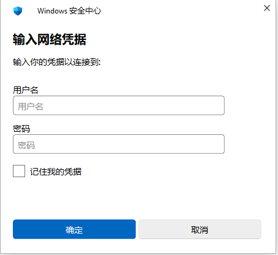

# CredentialUI

使用标准 C11、Win32 API 和 GDI 编写的网络凭据界面与 Explorer 接管工具，界面按提供的截图还原。



界面以 96 DPI 下的 **451 × 416** 为基准，包含标题栏盾牌、关闭按钮、标题、说明文字、用户名和密码输入框、记住凭据复选框、状态区及确定/取消按钮。

**“拒绝访问。”默认不显示。** 状态区保留原截图位置，显示或隐藏状态文字均不会改变其他控件的布局。

## 当前行为

- 用户名和密码支持输入、选择、复制粘贴、中文输入法及 Ctrl+A；密码以圆点遮罩显示，遵循原生密码框的复制限制。
- 输入框采用 1 逻辑像素的完整圆角描边，默认灰色（`#999999`），获取焦点后整圈变为蓝色（`#0078D7`）；空输入框显示占位文字。
- 复选框采用方形细边框、蓝底白勾，支持鼠标和空格切换；键盘操作时显示独立焦点框。
- 关闭图标在点击区域内居中，图标与对勾采用 8×8 子像素采样平滑；缩放时保持线宽和对称性。
- 确定按钮默认使用蓝色，取消按钮默认底色为 `#EEEEEE`；鼠标悬停时显示灰底、深灰描边和黑字，按下时进一步加深；键盘焦点单独标识。
- Tab / Shift+Tab 切换控件；Enter 触发当前按钮或默认“确定”。
- 取消、右上角关闭、Esc、Alt+F4 关闭窗口；标题栏可拖动，窗口大小固定。
- 实际 IPC 模式中，“确定”返回输入给 SSPI 桥接；复选框接入系统保存流程。在 WinPE 中双击或无参数启动自动启用接管；`--preview` 仅用于界面预览。
- 窗口采用与参考项目一致的 `UpdateLayeredWindow` 分层自绘，不依赖 DWM 绘制边框和阴影。
- Windows 内核 Build ≥ 22000 使用 16 逻辑像素的 G2 连续圆角，旧系统使用直角；外边框为 1 逻辑像素。
- 阴影包含环境阴影和向下偏移 4 逻辑像素的投影，遵循系统“在窗口下显示阴影”设置，并响应设置变化。
- 按用户要求保留任务栏按钮；激活或失去激活均保持窗口打开，重新激活恢复原控件焦点。
- 支持按显示器 DPI 缩放。

已接入请求/结果接口、IPC v2、自动覆盖当前会话同架构 Explorer 的桥接，以及认证成功后的系统凭据保存。网络连接仍由原 Explorer / SMB 流程完成。

使用方法、故障回退及范围见 [GUI 接入说明](docs/integration.md)，实测矩阵见 [测试报告](docs/test-report-2026-11-06.md)。

x64 / x86 均只交付一个 `CredentialUI.exe`。桥接 DLL 以内嵌资源打包，启用或手动挂接时自动准备到 `%TEMP%\CredentialUI\架构-内容哈希\`，同目录保留本版 EXE 的运行副本供独立 GUI 使用。无需另带 DLL，也不要求部署目录可写。双击或无参数运行 `CredentialUI.exe` 自动启用后台接管，凭据界面在实际认证请求时显示；重复启动保持已启用状态，新进程返回 183，不切换为停止。运行同程序 `--stop` 取消在途请求并撤销；`--status` 查询状态，`--attach PID` / `--detach PID` 手动操作指定进程。仅 `--preview` 为预览，不向网络提交，也不释放运行组件。`--run` 已移除，使用时返回参数错误 87。根目录的 start.cmd / stop.cmd 为可选启动脚本。

无参数启动（包括仅指定 `--log`）及 `--attach PID` 仅支持 WinPE：先通过系统 Windows 目录确认系统盘为 `X:`，再读取 `HKLM\SYSTEM\CurrentControlSet\Control` 下的字符串值 `SystemStartOptions`，检查是否包含 `MININT`（不区分大小写）。任一条件不满足或读取失败均拒绝，弹出“此功能仅支持 WindowsPE 环境”，返回 50（ERROR_NOT_SUPPORTED），不释放运行组件、不挂接目标。`--preview`、`--status`、`--stop`、`--detach` 和内部 `--ipc` 不受该环境限制。

默认不生成日志文件。排障时使用 `CredentialUI.exe --log "X:\Logs\credential.log"`，管理器和桥接共用指定文件。父目录须已存在，文件以 UTF-8 追加；相对路径、缺少路径或重复 --log 返回 87，文件无法打开时返回对应错误码。--status / --stop / --attach / --detach 也接受 --log，具体作用范围见 [诊断与撤销](docs/integration.md#诊断与撤销)。

单 EXE 版本已在 `192.168.75.128` 的 x64 WinPE 验证，结果见 [单 EXE 交付与验收](docs/single-exe-2026-11-06.md)。x86 已通过本机 WOW64 回归，32 位 WinPE / Explorer 的真实接管仍需独立验证。单 DLL 备选方案见 [单 DLL 设计讨论](docs/single-dll-design.md)。

## 目录结构

```text
CredentialUI/
├── CMakeLists.txt          # C11 项目和 Windows GUI 构建目标
├── README.md
├── .gitignore
├── include/
│   ├── credential_ui.h    # 请求、结果、预览和状态接口
│   ├── credential_ipc.h   # IPC v2
│   ├── credential_control.h # 会话控制和诊断
│   ├── credential_log.h   # 可选日志及桥接日志配置
│   ├── credential_runtime.h # 管理与手动挂接入口
│   ├── credential_environment.h # WinPE 环境判断与限制提示
│   └── credential_bundle.h # 单 EXE 运行组件准备接口
├── src/
│   ├── main.c             # 统一命令分发与 GUI/IPC 入口
│   ├── credential_environment.c # 系统盘与 MININT 检查
│   ├── credential_bundle.c # 内容哈希缓存、完整校验和原子释放
│   ├── credential_ui.c    # 窗口、布局、控件和交互
│   ├── ui_frame.c         # 分层窗口、G2 外框和双层阴影
│   ├── ui_frame.h         # 内部分层窗口接口
│   ├── ui_paint.c         # GDI 绘制和圆角抗锯齿
│   └── ui_paint.h         # 内部绘图接口
├── resources/
│   ├── app.rc             # 图标、清单和版本资源
│   ├── app.manifest       # DPI、通用控件和权限声明
│   ├── app.ico            # 原创盾牌程序图标
│   └── resource.h
├── bridge/                # DLL 桥接；管理器与注入功能编入统一 EXE
├── tests/                 # 协议、GUI、身份和保存边界测试
├── scripts/
│   └── build.ps1          # 自动探测工具链的构建脚本
├── docs/
│   ├── development.md     # 布局和后续功能接入说明
│   └── preview.png        # 本地程序实际截图
├── build/                 # 构建中间产物，已忽略
├── dist/                  # 构建结果，已忽略
│   ├── x64/               # 仅 CredentialUI.exe
│   └── x86/               # 仅 CredentialUI.exe
└── ref/
    └── OpenWith-for-WinPE/ # 用户提供的技术参考项目
```

## 构建

需要 Windows、CMake 3.20+，以及 MinGW-w64 GCC 或带 Windows SDK 的 Visual Studio C 工具链。MinGW 路线可搭配 Ninja 或 MinGW Make。

在项目根目录执行：

```powershell
.\scripts\build.ps1 -Architecture x64
.\scripts\build.ps1 -Architecture x86
```

输出分别位于 `dist/x64` 和 `dist/x86`，每个目录只交付 `CredentialUI.exe`。DLL 仍在 build 目录单独编译，随后自动嵌入 EXE；CMake install 也只安装 EXE。构建成功后仅清理 dist 对应架构目录中旧的 CredentialUIHost.exe / CredentialUIInjector.exe / CredentialUIBridge.dll。调试版本追加 `-Configuration Debug`。

脚本优先使用指定目录或 PATH 中与目标架构一致的 GCC，并检查常见安装位置；未找到时由 CMake 选择本机 Visual Studio。自定义 MinGW 路径可使用：

```powershell
.\scripts\build.ps1 -Architecture x64 -CompilerRoot 'D:\Tools\mingw64'
```

也可以直接使用 Visual Studio 生成器：

```powershell
cmake -S . -B build/msvc-x64 -A x64
cmake --build build/msvc-x64 --config Release
```

MinGW 下静态链接 GCC 辅助运行库；工具链支持时通过 `-mcrtdll=msvcrt-os` 使用系统 MSVCRT。MSVC 下使用静态 C 运行库。EXE 与内嵌桥接使用 Windows 系统 DLL；桥接依赖 SSPI / CredUI，内容哈希使用 Advapi32 的 CryptoAPI SHA-256。可用工具链的 objdump -p 检查各产物的导入表。

## 验证与兼容性

已用本机 GCC 16.2.0 分别构建 x64 / x86 Release，启用 `-Wall -Wextra -Wpedantic -Wconversion -Wshadow`，无编译警告。已通过 LCR 检查实际窗口、任务栏按钮、文本输入、密码遮罩、Tab 顺序、复选框、确定与关闭行为（该段为接入前界面验证，当前 IPC 提交验证见测试报告），并确认失去激活后窗口仍存在、重新激活可恢复控件焦点。分层绘制另外验证了 96 / 120 / 144 / 192 DPI 的形状对称、透明边缘、预乘 Alpha 和缓存重用。

代码以 Windows 7 API 基线组织，较新的 DPI 接口动态加载；外框、圆角和阴影不依赖 DWM。当前单 EXE 已在本机 Windows 桌面和指定 x64 WinPE 验证；Windows 7、原生 x86 WinPE 及多显示器 DPI 切换仍需在对应环境验证。字体优先使用系统的 Microsoft YaHei UI 和 Segoe UI；精简系统的字体配置可能影响显示效果。
